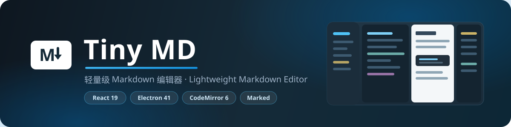

<div align="center">



# Tiny MD

[简体中文](./README.md) | **English**

[](https://github.com/cxlcym/Tiny-MD/actions/workflows/ci.yml)


A lightweight and flexible Markdown editor, available as a web app and a desktop app

[Features](#-features) • [Download](#-download) • [Quick Start](#-quick-start) • [Usage](#-usage) • [Shortcuts](#️-keyboard-shortcuts)

</div>

---

## 📖 Introduction

Tiny Markdown Editor (Tiny MD) is a lightweight and flexible Markdown editor featuring a four-panel layout (File Manager / Source / Preview / Translation), a YAML template system, multiple image-bed integrations, five translation engines, and custom preview styles. It ships as both a **web app** and a **desktop app (Electron)** — great for writing technical docs, publishing blog posts, and maintaining READMEs.

### 🖥️ Desktop Extras

The desktop app is built on Electron and adds, compared to the web version:

- **Local file system access**: no File System Access API required
- **Better image pasting**: a save dialog appears on paste and the Markdown image link is inserted automatically
- **Full folder support**: recursive directory loading, click-to-open file tree, rename / delete applied to disk
- **Unsaved-changes guard**: you are asked to confirm before closing a window with unsaved changes

## ✨ Features

### 📝 Editing

- ✅ Four-panel layout (File Manager / Source / Preview / Translation) with resizable panels
- ✅ Real-time Markdown preview with synchronized scrolling
- ✅ Code block syntax highlighting (20+ languages bundled)
- ✅ Quick-edit toolbar (headings, bold, lists, tables, code blocks, etc.)
- ✅ Non-intrusive syntax hints (unclosed markers, empty links)
- ✅ All rendered HTML sanitized with DOMPurify (XSS-safe)

### 📁 File Manager

- ✅ Open folders (recursive tree view)
- ✅ Rename and delete files (applied to disk on desktop)
- ✅ Collapse / expand folders, lazy loading for large folders
- ✅ Unsaved-file indicators
- ✅ Create / open single files

### 🎨 Preview Styles

- ✅ 5 preset styles (Default, GitHub, Notion, Medium, Book)
- ✅ Custom CSS styles
- ✅ Dark / light theme

### 🌍 UI Languages

- ✅ Chinese / English interface

### 📋 YAML Templates

- ✅ Preset templates (Hugo, Hexo, etc.)
- ✅ Dynamic placeholder substitution
- ✅ Full template CRUD
- ✅ One-click insert / update of YAML front matter

### 🖼️ Image Hosting

- ✅ PicGo local service proxy
- ✅ Cloudflare R2 support
- ✅ AWS S3 support
- ✅ Batch upload of local images
- ✅ Clipboard paste auto-converted to WebP

### 🌐 Multi-Engine Translation

- ✅ Google Translate (free, unofficial)
- ✅ MyMemory (free, 5,000 chars/day)
- ✅ DeepL Free (free, 500,000 chars/month)
- ✅ LibreTranslate (open source, self-hostable)
- ✅ Custom LLM (OpenAI-compatible)
- ✅ Custom translation prompts
- ✅ YAML front matter automatically excluded

### 📄 File Operations

- ✅ New / open / save, save as
- ✅ Unsaved-changes warning (web and desktop)
- ✅ Auto-saved drafts (localStorage, debounced writes)
- ✅ Word count with CJK support

---

## 📥 Download

### Desktop (Recommended)

Grab a portable build for your platform from [GitHub Releases](https://github.com/cxlcym/Tiny-MD/releases) — no installation needed, just download and run.

| Platform | Format |
|----------|--------|
| Windows | Portable `.exe` |
| macOS | `.dmg` |
| Linux | `.AppImage` |

### Web

Clone and build; the output lands in the `dist` directory:

```bash
git clone https://github.com/cxlcym/Tiny-MD.git
cd Tiny-MD
npm install
npm run build
```

---

## 🚀 Quick Start

### Requirements

- Node.js >= 18
- npm

### Install & Run

```bash
# Clone
git clone https://github.com/cxlcym/Tiny-MD.git

# Enter the project
cd Tiny-MD

# Install dependencies
npm install

# Start the web dev server
npm run dev

# Start the desktop app in dev mode
npm run electron:dev

# Build for production (web)
npm run build

# Build the desktop app (Windows / macOS / Linux)
npm run electron:build:win
```

Once the dev server is running, open `http://localhost:5173`

---

## 📖 Usage

### Basics

| Action | How |
|--------|-----|
| New file | Click `+ New` or press `Ctrl+N` |
| Open file | Click `📂 Open` or press `Ctrl+O` |
| Save | Click `💾 Save` or press `Ctrl+S` |
| Save as | Click `📄 Save As` or press `Ctrl+Shift+S` |

### File Manager

| Action | How |
|--------|-----|
| Open folder | Click the folder icon and pick a folder |
| Collapse panel | Click the panel header |
| Rename file | Hover a file and click the edit icon (synced to disk on desktop) |
| Delete file | Hover a file and click the trash icon (synced to disk on desktop) |

### YAML Templates

1. Click the `YAML` toolbar button (or press `Ctrl+Shift+Y`)
2. Pick a preset template or create a new one
3. Supported placeholders:

| Placeholder | Description |
|-------------|-------------|
| `{{title}}` | Document title |
| `{{date}}` | Current date |
| `{{time}}` | Unix timestamp |
| `{{datetime}}` | Current date and time |
| `{{image}}` | Cover image path |
| `{{category}}` | Category |
| `{{tags}}` | Tags |

### Preview Styles

1. Click the `🎨 Styles` toolbar button
2. Choose a preset style or add custom CSS
3. Styles are saved to local storage

### Image Upload

1. **PicGo upload**
   - Click the `PicGo` toolbar button
   - Configure the PicGo endpoint (default `http://127.0.0.1:36677`)
   - Click "Batch Upload Local Images" to scan and upload images referenced in the article

2. **Clipboard paste**
   - Copy an image, then press `Ctrl+V` in the editor
   - **Desktop**: a save dialog appears and `` is inserted automatically
   - **Web**: the image is converted to WebP, downloaded, and referenced by local path

### Translation

1. Pick a translation engine and target language in the Translation panel
2. Click "Translate"; the result is rendered in the panel

### LLM Translation Setup

Configure a custom LLM API in the settings panel:

- **API Key**: an OpenAI-compatible key
- **API URL**: the endpoint URL
- **Translation Prompt**: a custom system prompt; use the `{{targetLanguage}}` placeholder

---

## ⌨️ Keyboard Shortcuts

| Shortcut | Action |
|----------|--------|
| `Ctrl+N` | New file |
| `Ctrl+O` | Open file |
| `Ctrl+S` | Save |
| `Ctrl+Shift+S` | Save as |
| `Ctrl+Shift+Y` | YAML templates |
| `Ctrl+Shift+P` | PicGo upload |
| `Ctrl+Z` | Undo |
| `Ctrl+Shift+Z` | Redo |

---

## 🛠️ Tech Stack

| Component | Technology |
|-----------|------------|
| Frontend | React 19 + Vite |
| Desktop | Electron 41 |
| Editor core | CodeMirror 6 |
| Markdown parsing | Marked + marked-highlight |
| Syntax highlighting | Highlight.js (languages registered on demand) |
| HTML sanitization | DOMPurify |
| Styling | CSS Variables (dark / light themes) |

---

## 🔒 Security Notes

- All rendered Markdown output is sanitized with **DOMPurify** to prevent script injection from malicious documents
- Desktop IPC file operations are restricted to **text files** (`.md` / `.markdown` / `.txt`); image reads are restricted to image extensions
- API keys are stored in plain text in the browser's localStorage — avoid using them on shared computers

---

## 📁 Project Structure

```
tiny-md/
├── electron/
│   ├── main.cjs             # Electron main process (IPC, recursive dirs, close guard)
│   └── preload.cjs          # Electron preload script (contextBridge)
├── src/
│   ├── components/
│   │   ├── Editor/          # CodeMirror editor
│   │   ├── Preview/         # Markdown preview (custom styles)
│   │   ├── Translation/     # Translation panel (multi-engine)
│   │   ├── Toolbar/         # Toolbar
│   │   ├── StatusBar/       # Status bar
│   │   ├── QuickEdit/       # Quick-edit toolbar
│   │   ├── YAMLTemplate/    # YAML template manager
│   │   ├── ImageUpload/     # Image upload
│   │   ├── Settings/        # Settings panel
│   │   ├── FileManager/     # File manager
│   │   ├── StyleSelector/   # Preview style selector
│   │   └── HljsTheme/       # Highlight theme (bundled, works offline)
│   ├── services/
│   │   └── imageUpload/     # Image hosting services
│   ├── hooks/
│   │   ├── useFileWorkspace.js      # File workspace state (reducer, single source of truth)
│   │   ├── useTranslationEngines.js # Multi-engine translation
│   │   └── useLocalStorage.js       # localStorage hook (debounce support)
│   ├── utils/
│   │   ├── markdown.js      # Markdown rendering (marked + DOMPurify)
│   │   ├── yaml.js          # YAML front matter utilities
│   │   ├── imageUtils.js    # Image utilities (WebP conversion, etc.)
│   │   └── i18n.js          # Internationalization strings
│   ├── App.jsx              # Root app component
│   ├── App.css              # App styles (theme variables)
│   └── index.css            # Global styles
├── .github/                 # CI workflows and assets
├── public/                  # Static assets
├── package.json
└── vite.config.js
```

---

## 🔧 Configuration

### Image Hosting

Configurable in the settings panel:

| Type | Notes |
|------|-------|
| PicGo service | Local proxy; requires PicGo installed |
| Cloudflare R2 | Requires Account ID, Access Key, Bucket |
| AWS S3 | Requires Access Key, Bucket, Region |

### Translation APIs

| Engine | Free Quota | Setup |
|--------|------------|-------|
| Google Translate | Unlimited (unofficial) | None |
| MyMemory | 5,000 chars/day | None |
| DeepL Free | 500,000 chars/month | API key required |
| LibreTranslate | Unlimited (self-hosted) | Optional endpoint |
| Custom LLM | Depends on API | API key + URL required |

### Browser Compatibility (Web)

| Feature | Chrome | Edge | Firefox | Safari |
|---------|--------|------|---------|--------|
| Basic editing | ✅ | ✅ | ✅ | ✅ |
| Open folder | ✅ | ✅ | ❌ | ❌ |
| File saving | ✅ | ✅ | ❌ | ❌ |

> Opening folders and saving files rely on the File System Access API

---

## 📄 License

[MIT License](LICENSE)

---

## 🤝 Contributing

Issues and pull requests are welcome!

---

<div align="center">

Made with ❤️ by jack Cao
Powered by Gemini 4 Neon

</div>
