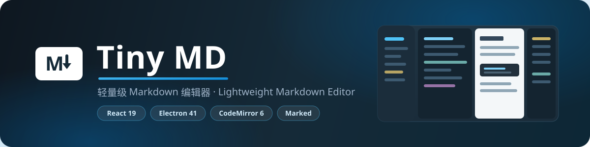

<div align="center">



# Tiny MD

**简体中文** | [English](./README.en.md)

[](https://github.com/cxlcym/Tiny-MD/actions/workflows/ci.yml)


一款轻量级且灵活的 Markdown 编辑器，支持 Web 版和桌面版

[功能特性](#-功能特性) • [下载安装](#-下载安装) • [快速开始](#-快速开始) • [使用指南](#-使用指南) • [快捷键](#️-快捷键)

</div>

---

## 📖 简介

Tiny Markdown Editor（Tiny MD）是一款轻量级且灵活的 Markdown 编辑器，支持四栏布局（文件管理器 / 源码 / 预览 / 翻译）、YAML 模板系统、多图床集成、五种翻译引擎、自定义预览样式等功能。提供 **Web 版**和**桌面版（Electron）**两种形态，适用于技术文档编写、博客发布和 README 维护场景。

### 🖥️ 桌面版特性

桌面版基于 Electron 构建，相比 Web 版具有以下优势：

- **本地文件系统访问**：无需依赖 File System Access API
- **图片粘贴优化**：粘贴图片时弹出保存对话框，选择位置后自动插入 Markdown 格式
- **文件夹全量支持**：递归加载子目录，文件树点击即开，重命名 / 删除直接作用于磁盘
- **未保存关闭提醒**：关闭窗口前会确认未保存的更改

## ✨ 功能特性

### 📝 基础编辑

- ✅ 四栏布局（文件管理器 / 源码 / 预览 / 翻译），面板可拖动调整大小
- ✅ 实时 Markdown 预览与同步滚动
- ✅ 代码块语法高亮（内置 20+ 常用语言）
- ✅ 快捷编辑工具栏（标题、加粗、列表、表格、代码块等）
- ✅ 语法提示（未闭合标记、空链接等低干扰提示）
- ✅ Markdown 渲染输出经 DOMPurify 净化，防御 XSS

### 📁 文件管理器

- ✅ 打开文件夹（递归树状结构显示）
- ✅ 文件重命名和删除（桌面版直接作用于磁盘）
- ✅ 折叠 / 展开文件夹，大文件夹按需加载
- ✅ 未保存文件标识
- ✅ 新建 / 打开单个文件

### 🎨 预览样式

- ✅ 5 种预设样式（Default、GitHub、Notion、Medium、Book）
- ✅ 支持自定义 CSS 样式
- ✅ 深色 / 浅色主题切换

### 🌍 界面多语言

- ✅ 中文 / 英文界面切换

### 📋 YAML 模板系统

- ✅ 预设多个模板（Hugo、Hexo 等）
- ✅ 动态占位符自动填充
- ✅ 模板增删改查
- ✅ 一键插入 / 更新 YAML Front-matter

### 🖼️ 图床集成

- ✅ PicGo 本地服务代理
- ✅ Cloudflare R2 支持
- ✅ AWS S3 支持
- ✅ 批量上传本地图片
- ✅ 剪贴板图片粘贴自动转换 WebP

### 🌐 多引擎翻译

- ✅ Google Translate（免费，非官方）
- ✅ MyMemory（免费，每天 5000 字符）
- ✅ DeepL Free（免费，每月 50 万字符）
- ✅ LibreTranslate（开源自托管）
- ✅ 自定义 LLM（支持 OpenAI 格式）
- ✅ 自定义翻译提示词
- ✅ 自动过滤 YAML 区块

### 📄 文件操作

- ✅ 新建 / 打开 / 保存文档、另存为
- ✅ 未保存文件提醒（Web 与桌面版均支持）
- ✅ 自动保存草稿（本地存储，防抖写入）
- ✅ 中英文混排字数统计

---

## 📥 下载安装

### 桌面版（推荐）

前往 [GitHub Releases](https://github.com/cxlcym/Tiny-MD/releases) 下载对应平台的便携版，无需安装，下载后双击即可运行。

| 平台 | 格式 |
|------|------|
| Windows | 便携版 `.exe` |
| macOS | `.dmg` |
| Linux | `.AppImage` |

### Web 版

克隆项目后自行构建，构建产物在 `dist` 目录中：

```bash
git clone https://github.com/cxlcym/Tiny-MD.git
cd Tiny-MD
npm install
npm run build
```

---

## 🚀 快速开始

### 环境要求

- Node.js >= 18
- npm

### 安装与启动

```bash
# 克隆项目
git clone https://github.com/cxlcym/Tiny-MD.git

# 进入项目目录
cd Tiny-MD

# 安装依赖
npm install

# 启动 Web 版开发服务器
npm run dev

# 启动桌面版开发模式
npm run electron:dev

# 构建生产版本（Web）
npm run build

# 构建桌面版（Windows / macOS / Linux）
npm run electron:build:win
```

开发服务器启动后，访问 `http://localhost:5173`

---

## 📖 使用指南

### 基础操作

| 操作 | 说明 |
|------|------|
| 新建文档 | 点击 `+ 新建` 按钮或按 `Ctrl+N` |
| 打开文档 | 点击 `📂 打开` 按钮或按 `Ctrl+O` |
| 保存文档 | 点击 `💾 保存` 按钮或按 `Ctrl+S` |
| 另存为 | 点击 `📄 另存为` 按钮或按 `Ctrl+Shift+S` |

### 文件管理器

| 操作 | 说明 |
|------|------|
| 打开文件夹 | 点击文件夹图标，选择文件夹 |
| 折叠面板 | 点击面板标题栏 |
| 重命名文件 | 悬停文件，点击编辑图标（桌面版同步到磁盘） |
| 删除文件 | 悬停文件，点击删除图标（桌面版同步到磁盘） |

### YAML 模板

1. 点击工具栏的 `YAML` 按钮（或按 `Ctrl+Shift+Y`）
2. 选择预设模板或创建新模板
3. 模板支持以下占位符：

| 占位符 | 说明 |
|--------|------|
| `{{title}}` | 文档标题 |
| `{{date}}` | 当前日期 |
| `{{time}}` | 时间戳 |
| `{{datetime}}` | 日期时间 |
| `{{image}}` | 封面图路径 |
| `{{category}}` | 分类 |
| `{{tags}}` | 标签 |

### 预览样式

1. 点击工具栏的 `🎨 样式` 按钮
2. 选择预设样式或添加自定义 CSS
3. 样式会保存到本地存储

### 图片上传

1. **PicGo 上传**
   - 点击工具栏的 `PicGo` 按钮
   - 配置 PicGo 服务地址（默认 `http://127.0.0.1:36677`）
   - 点击"批量上传本地图片"扫描并上传文章中的本地图片

2. **剪贴板粘贴**
   - 复制图片到剪贴板，在编辑器中按 `Ctrl+V`
   - **桌面版**：弹出保存对话框，选择位置后自动插入 ``
   - **Web 版**：图片自动转换为 WebP 并下载，插入本地路径引用

### 翻译功能

1. 在翻译面板选择翻译引擎和目标语言
2. 点击"翻译"按钮，结果渲染在翻译面板中

### LLM 翻译配置

在设置面板配置自定义 LLM API：

- **API Key**：OpenAI 或兼容 API 的密钥
- **API URL**：API 端点地址
- **翻译提示词**：可自定义 system prompt，使用 `{{targetLanguage}}` 占位符

---

## ⌨️ 快捷键

| 快捷键 | 功能 |
|--------|------|
| `Ctrl+N` | 新建文档 |
| `Ctrl+O` | 打开文档 |
| `Ctrl+S` | 保存文档 |
| `Ctrl+Shift+S` | 另存为 |
| `Ctrl+Shift+Y` | YAML 模板 |
| `Ctrl+Shift+P` | PicGo 上传 |
| `Ctrl+Z` | 撤销 |
| `Ctrl+Shift+Z` | 重做 |

---

## 🛠️ 技术栈

| 组件 | 技术 |
|------|------|
| 前端框架 | React 19 + Vite |
| 桌面框架 | Electron 41 |
| 编辑器核心 | CodeMirror 6 |
| Markdown 解析 | Marked + marked-highlight |
| 代码高亮 | Highlight.js（按需注册语言） |
| HTML 净化 | DOMPurify |
| 样式 | CSS Variables（深色 / 浅色主题） |

---

## 🔒 安全说明

- 所有 Markdown 渲染输出均经过 **DOMPurify** 净化，防止恶意文档注入脚本
- 桌面版 IPC 文件操作**仅允许文本文件**（`.md` / `.markdown` / `.txt`），图片读取仅允许图片扩展名
- API 密钥以明文保存在浏览器 localStorage 中，请勿在公用电脑上使用

---

## 📁 项目结构

```
tiny-md/
├── electron/
│   ├── main.cjs             # Electron 主进程（IPC、目录递归、关闭确认）
│   └── preload.cjs          # Electron 预加载脚本（contextBridge）
├── src/
│   ├── components/
│   │   ├── Editor/          # CodeMirror 编辑器
│   │   ├── Preview/         # Markdown 预览（支持自定义样式）
│   │   ├── Translation/     # 翻译面板（多引擎支持）
│   │   ├── Toolbar/         # 工具栏
│   │   ├── StatusBar/       # 状态栏
│   │   ├── QuickEdit/       # 快捷编辑工具栏
│   │   ├── YAMLTemplate/    # YAML 模板管理
│   │   ├── ImageUpload/     # 图片上传
│   │   ├── Settings/        # 设置面板
│   │   ├── FileManager/     # 文件管理器
│   │   ├── StyleSelector/   # 预览样式选择器
│   │   └── HljsTheme/       # 高亮主题（本地打包，离线可用）
│   ├── services/
│   │   └── imageUpload/     # 图床服务
│   ├── hooks/
│   │   ├── useFileWorkspace.js     # 文件工作区状态（reducer 单一数据源）
│   │   ├── useTranslationEngines.js # 多引擎翻译
│   │   └── useLocalStorage.js      # 本地存储（支持防抖）
│   ├── utils/
│   │   ├── markdown.js      # Markdown 渲染（marked + DOMPurify）
│   │   ├── yaml.js          # YAML Front-matter 处理
│   │   ├── imageUtils.js    # 图片处理（WebP 转换等）
│   │   └── i18n.js          # 国际化翻译文件
│   ├── App.jsx              # 主应用组件
│   ├── App.css              # 应用样式（主题变量）
│   └── index.css            # 全局样式
├── .github/                 # CI 工作流与资源
├── public/                  # 静态资源
├── package.json
└── vite.config.js
```

---

## 🔧 配置说明

### 图床配置

在设置面板可以配置以下图床：

| 类型 | 说明 |
|------|------|
| PicGo 服务 | 本地代理服务，需安装 PicGo |
| Cloudflare R2 | 需配置 Account ID、Access Key、Bucket |
| AWS S3 | 需配置 Access Key、Bucket、Region |

### 翻译 API 配置

| 引擎 | 免费额度 | 配置要求 |
|------|----------|----------|
| Google Translate | 无限制（非官方） | 无需配置 |
| MyMemory | 每天 5000 字符 | 无需配置 |
| DeepL Free | 每月 50 万字符 | 需要 API Key |
| LibreTranslate | 无限制（自托管） | 可配置服务地址 |
| 自定义 LLM | 取决于 API | 需要 API Key 和 URL |

### 浏览器兼容性（Web 版）

| 功能 | Chrome | Edge | Firefox | Safari |
|------|--------|------|---------|--------|
| 基础编辑 | ✅ | ✅ | ✅ | ✅ |
| 打开文件夹 | ✅ | ✅ | ❌ | ❌ |
| 文件保存 | ✅ | ✅ | ❌ | ❌ |

> 注：打开文件夹和文件保存功能需要 File System Access API 支持

---

## 📄 许可证

[MIT License](LICENSE)

---

## 🤝 贡献

欢迎提交 Issue 和 Pull Request！

---

<div align="center">

Made with ❤️ by jack Cao
Powered by OpenCode + MiMo V2 Pro

</div>
