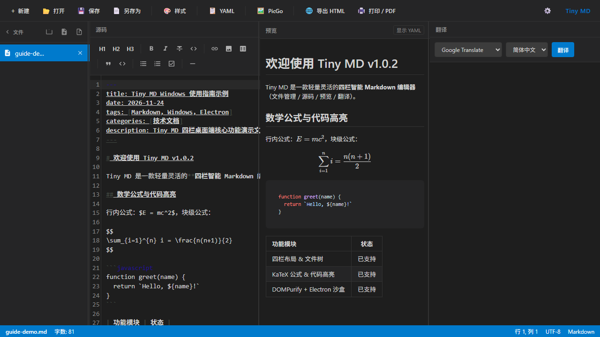
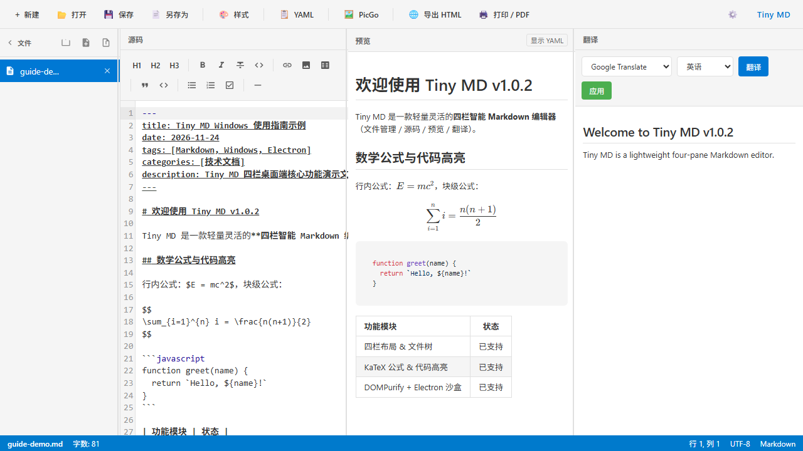
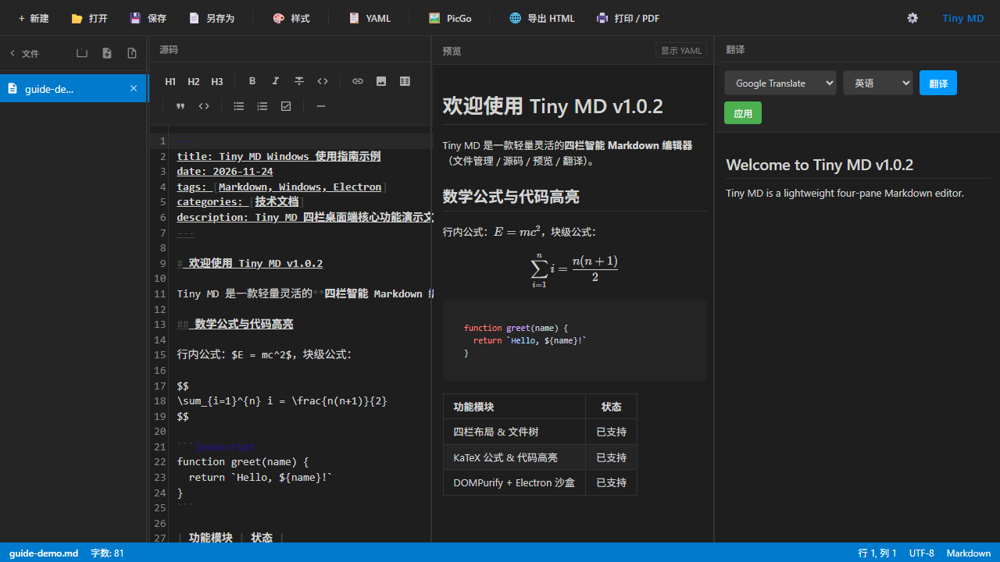
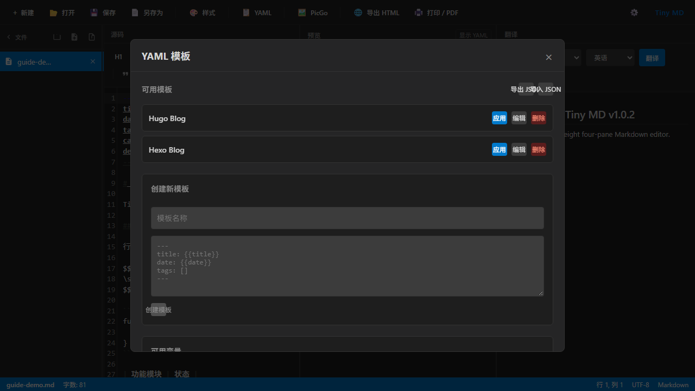
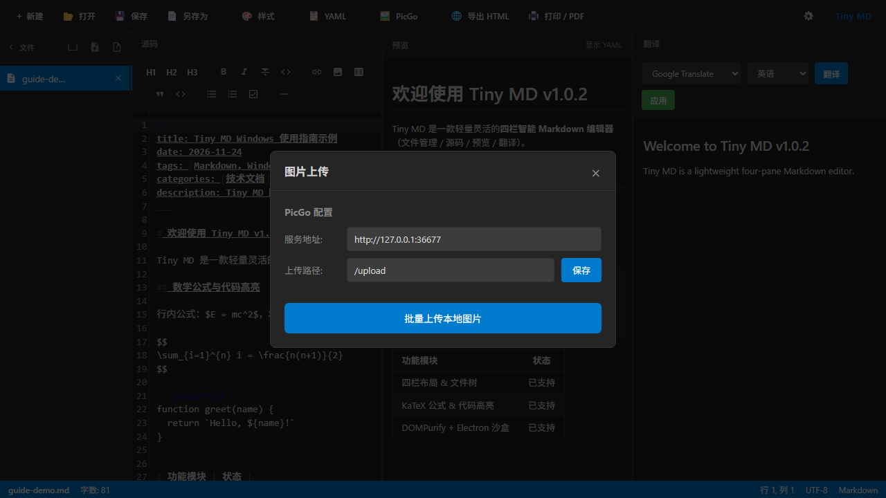
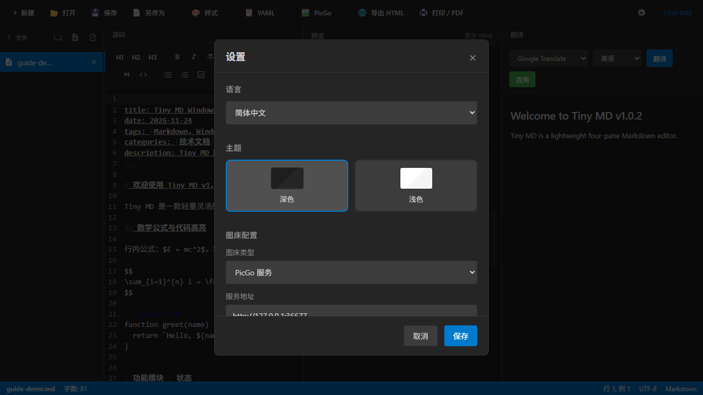

# Tiny MD Windows 用户操作使用手册（v1.0.2）

欢迎使用 **Tiny MD** —— 一款轻量、灵活的 Windows 桌面端**四栏智能 Markdown 编辑器**（文件管理 / 源码 / 预览 / 翻译）。

---

## 1. Windows 安装与上手指南

### 1.1 系统要求
- **操作系统**：Windows 10 / Windows 11（64 位 x64）
- **推荐分辨率**：1280 × 720 及以上
- **磁盘空间**：至少 250 MB 可用空间

### 1.2 安装方式（`release/` 目录）
1. **标准安装版（推荐）**：双击 `Tiny MD Setup 1.0.2.exe`，按向导选择安装路径，安装完成后自动创建桌面与开始菜单快捷方式，可在 Windows「设置 → 应用」中标准卸载。
2. **绿色便携版（免安装）**：双击 `Tiny MD 1.0.2.exe` 即可直接运行，适合随身携带或免权限环境。

### 1.3 首次运行 Windows SmartScreen 提示处理
如弹出 **“Windows 已保护你的电脑”** 提示：
1. 点击 **“更多信息”**；
2. 确认文件为本地打包的 `Tiny MD Setup 1.0.2.exe` 或 `Tiny MD 1.0.2.exe`；
3. 点击 **“仍要运行”** 即可继续安装或启动。

### 1.4 数据与配置存储位置
- 本地应用数据目录：`%APPDATA%\tiny-md\`（即 `C:\Users\<用户名>\AppData\Roaming\tiny-md\`）
- 文档草稿、配置项、自定义样式与 YAML 模板均存储在本地。

---

## 2. 四栏界面与核心功能操作

### 2.1 四栏主界面总览
主界面由左至右包含 **文件管理器（可折叠）**、**源码**、**预览**、**翻译** 四个可拖拽调整宽度的面板：

- **文件管理器**：支持打开本地文件夹（递归树状加载 `.md` 文件）、新建/打开单个文件、重命名与删除（桌面版直接作用于磁盘）、折叠/展开侧边栏。
- **源码区**：CodeMirror 6 编辑器，支持行号、Markdown 高亮、括号补全、低干扰语法提示与 16 个快捷编辑按钮（标题 H1–H3、加粗、斜体、删除线、行内代码、链接、插入本地图片、表格、引用、代码块、无序/有序/任务列表、分割线）。
- **预览区**：
  - 实时渲染 GFM Markdown、**离线 Highlight.js 代码高亮**、**KaTeX 数学公式**（`$E=mc^2$` 与 `$$...$$`）。
  - 工具栏 **`样式`（🎨）** 支持切换 5 种预设样式（Default / GitHub / Notion / Medium / Book）及自定义 CSS（内置样式逃逸防护）。
  - 预览区右上角 **`显示 YAML` / `隐藏 YAML`** 可一键切换是否预览顶部 Front-matter。
  - 经 **DOMPurify** 严格净化，阻断 XSS 脚本执行。
- **文档导出**：点击工具栏 **`导出 HTML`** 生成独立安全 HTML 文件，点击 **`打印 / PDF`** 唤起系统打印导出 PDF。

### 2.2 浅色与深色主题切换
通过右上角 **`设置`（⚙️）** 一键切换深色/浅色主题与简体中文/English 界面：

### 2.3 五引擎翻译（自动保护 YAML + 一键应用）
在右侧 **翻译** 面板选择引擎（`Google Translate`、`MyMemory`、`DeepL Free`、`LibreTranslate`、`自定义 LLM`）及目标语言，点击 **`翻译`** 后自动跳过顶部 YAML 仅翻译正文；完成后点击 **`应用`** 即可一键回写源码区。

### 2.4 YAML 模板管理（含 JSON 导入/导出）
点击工具栏 **`YAML`**（`Ctrl+Shift+Y`）打开模板弹窗，支持一键应用（自动填充 `{{title}}`、`{{date}}`、`{{time}}`、`{{datetime}}`、`{{image}}`、`{{category}}`、`{{tags}}`）、模板增删改查以及 **`导出 JSON`** / **`导入 JSON`** 备份迁移。

### 2.5 图片粘贴与 PicGo 批量上传
- 在源码区按 `Ctrl+V` 粘贴截图自动转为 `.webp` 并弹出原生保存框插入文档；
- 点击工具栏 **`PicGo`**（`Ctrl+Shift+P`）配置服务地址并一键 **`批量上传本地图片`**，自动替换正文链接。

---

## 3. 配置说明（设置面板）

点击右上角 **`设置`（⚙️）** 打开偏好设置弹窗：

| 配置区块 | 配置项 | 说明 |
| :--- | :--- | :--- |
| **语言 / 主题** | `语言` / `主题` | `English` / `简体中文`，`深色` / `浅色` |
| **图床配置** | `PicGo 服务` / `Cloudflare R2` / `AWS S3` | PicGo 默认 `http://127.0.0.1:36677` + `/upload`；R2/S3 按云控制台填写凭证与存储桶 |
| **翻译 API 配置** | `DeepL API 密钥` / `LibreTranslate 服务地址` | DeepL 免费版每月 50 万字符；LibreTranslate 默认 `https://libretranslate.com` |
| **LLM 配置** | `API 密钥` / `API 地址` / `模型名称` / `翻译提示词` | 支持 OpenAI 及兼容接口，支持点击 **`测试连通性`** 验证可用性 |

---

## 4. Windows 快捷键对照表

| 快捷键 | 功能 |
| :--- | :--- |
| `Ctrl + N` / `Ctrl + O` | 新建 / 打开 `.md` 文件 |
| `Ctrl + S` / `Ctrl + Shift + S` | 保存 / 另存为 |
| `Ctrl + B` / `Ctrl + I` / `Ctrl + K` | 加粗 / 斜体 / 插入链接 |
| `Ctrl + Z` / `Ctrl + Y` | 撤销 / 重做 |
| `Ctrl + F` | 查找与替换 |
| `Ctrl + Shift + Y` / `Ctrl + Shift + P` | 打开 YAML 模板 / PicGo 图片上传 |
| `Ctrl + V` | 粘贴文本或剪贴板图片（自动转 WebP） |

---

## 5. 常见问题排查（FAQ）

1. **Q：PicGo 批量上传失败怎么办？**  
   **A**：请先启动本地 PicGo 客户端并在设置中开启 Server（默认端口 `36677`），核对服务地址与上传路径后重试。
2. **Q：Google 翻译超时或连接失败？**  
   **A**：请切换为 MyMemory、DeepL Free 或在设置中配置可直连的自定义 LLM API，并点击“测试连通性”确认接口正常。
3. **Q：打开 Windows CRLF (`\r\n`) 格式的 `.md` 文件 YAML 能否识别？**  
   **A**：完全支持，v1.0.2 已全面兼容 `\r\n` 与 `\n` 换行符及带连字符的 YAML 键名。
4. **Q：编辑 1MB~5MB 超大文档是否卡顿？**  
   **A**：已内置大文档输入防抖与 150KB 预览保护机制，实测 1MB 文档输入延迟约 44ms。
5. **Q：关闭窗口时为何弹窗拦截？**  
   **A**：当文件存在未保存更改（带 `●` 标记）时，桌面端会主动二次确认防止数据丢失。
6. **Q：如何备份模板与配置？**  
   **A**：YAML 模板可在模板弹窗点 **`导出 JSON`**；全量本地配置位于 `%APPDATA%\tiny-md\` 目录。
